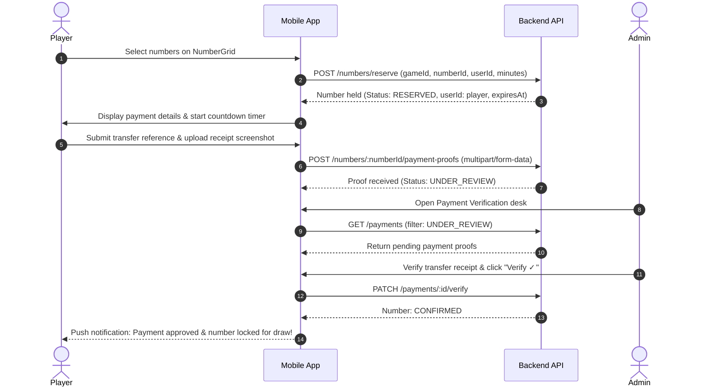

# Bingo Mobile Application

A cross-platform mobile application built with **React Native (Expo SDK 57)** and **TypeScript** designed to manage and participate in centralized Bingo games.

---

## Table of Contents

1. [Application Overview](#application-overview)
2. [Core Architecture & Database Lifecycle](#core-architecture--database-lifecycle)
3. [User Roles & Permissions](#user-roles--permissions)
   - [Player Role](#player-role)
   - [Admin Role](#admin-role)
4. [Project Directory Structure](#project-directory-structure)
5. [Complete Code & Component Directory](#complete-code--component-directory)
   - [App Navigation & Screens (`src/app/`)](#1-app-navigation--screens-srcapp)
   - [Reusable UI Components (`src/components/ui/`)](#2-reusable-ui-primitives-srccomponentsui)
   - [Common & Layout Components (`src/components/common/` & `layout/`)](#3-common--layout-components-srccomponentscommon--layout)
   - [Feature Modules (`src/features/`)](#4-feature-modules-srcfeatures)
   - [State Management & Context (`src/context/`)](#5-state-management--context-srccontext)
   - [API & Service Layer (`src/services/`)](#6-api--service-layer-srcservices)
   - [Data Models & Types (`src/types/`)](#7-data-models--types-srctypes)
   - [Internationalization (`src/i18n/`)](#8-internationalization-srci18n)
   - [Shared Utilities & Constants (`src/shared/`, `src/constants/`, `src/hooks/`)](#9-shared-utilities--hooks)
6. [Payment & Number Hold Synchronization Workflow](#payment--number-hold-synchronization-workflow)
7. [Draw Eligibility & Prize Distribution](#draw-eligibility--prize-distribution)
8. [Setup & Execution Commands](#setup--execution-commands)

---

## Application Overview

The Bingo Application provides a transparent, secure, and mobile-friendly environment for real-time Bingo gaming. Players can view active games, choose numbers on interactive grids, create temporary holds, submit manual payment proofs (e.g., **Telebirr**, **CBE**, **Awash Bank**, **Absina**), and participate in official draws.

Administrators manage game configurations (total numbers, countdown timers, prize distributions), review payment receipts, verify transactions, execute draws, and audit all critical system actions.

---

## Core Architecture & Single-Table Database Model

The backend uses a single-table inventory and booking architecture where user hold parameters (`userId`, `expiresAt`) are maintained directly within the **`game_numbers`** table. The separate `reservations` table is completely eliminated, eliminating synchronization bugs and enabling atomic row locks:

```
┌────────────────────────────────────────────────────────┐
│                      Number Table                      │
├────────────────────────────────────────────────────────┤
│ • id: number (PK)                                      │
│ • gameId: number (FK -> games)                         │
│ • number: number (1..N)                                │
│ • status: AVAILABLE | RESERVED | CONFIRMED              │
│ • userId: number | null (set when reserved)
  • createId: number | null (who create game ) │
  • confirmId: number | null (who set when confirmed/rejected)
│ • expiresAt: timestamp | null (countdown expiration)   │
│ • createdAt: timestamp                                 │
│ • updatedAt: timestamp
                             │
└────────────────────────────────────────────────────────┘
```

### State Lifecycle Rules

| Player / Admin Action                      | Number Status | User & Expiry Fields                            | Resulting State                                                     |
| :----------------------------------------- | :------------ | :---------------------------------------------- | :------------------------------------------------------------------ |
| **Game initialized**                       | `AVAILABLE`   | `userId = null, expiresAt = null`               | Number is open for any player to select.                            |
| **Player holds available number**          | `RESERVED`    | `userId = player.id, expiresAt = now + minutes` | Temporary hold created with countdown timer (`reservationMinutes`). |
| **Timer expires without verified payment** | `AVAILABLE`   | `userId = null, expiresAt = null`               | Auto-expired by backend worker; released back to pool.              |
| **Player cancels pending hold**            | `AVAILABLE`   | `userId = null, expiresAt = null`               | Released back to pool immediately.                                  |
| **Admin verifies payment receipt**         | `CONFIRMED`   | `userId = player.id, expiresAt = locked`        | Locked permanently. Eligible for the Bingo draw.                    |
| **Admin rejects invalid payment proof**    | `AVAILABLE`   | `userId = null, expiresAt = null`               | Number released back to available pool.                             |

---

## User Roles & Permissions

### Player Role

The Player interface provides all features required for participating in games:

1. **Authentication**: Register with phone number and name; log in with session persistence via `@react-native-async-storage/async-storage`.
2. **Dashboard**: View active games, upcoming games, personal reservation counters, and win stats.
3. **Game Browsing & Details**: Inspect game status, total numbers, reservation timeout, and live number boards.
4. **Number Reservation**: Multi-select available numbers; triggers reservation API with synchronized locking.
5. **Payment Submission**: View bank/merchant account information for CBE, Telebirr, Awash, Absina; enter transaction reference number and upload receipt screenshot.
6. **Reservation Tracking**: Filter reservations by `ALL`, `PENDING`, `CONFIRMED`, `CANCELLED`, `EXPIRED`; pay pending holds or cancel before timeout.
7. **Draw Results & History**: View published winner announcements, winning numbers, and prize disbursements.
8. **Notifications**: Stay updated on payment approval status, reservation timeouts, and upcoming games.
9. **Profile & Settings**: View and update account profile, toggle Dark/Light mode, change language (English, Amharic, Afaan Oromo).

### Admin Role

The Admin interface is a dedicated management console:

1. **Admin Dashboard**: Live metrics for total games, total reservations, and pending payment receipts awaiting verification.
2. **Game Management**: Create new games with custom title, total numbers (e.g., 25, 50, 75), reservation hold duration (in minutes), entry price, and customizable prize distribution percentages.
3. **Number Inventory**: Real-time visual grid of all numbers across all games categorized by `AVAILABLE`, `RESERVED`, and `CONFIRMED`.
4. **Reservation Management**: Filter and review every player reservation; inspect expiration timestamps; audit canceled and expired entries.
5. **Manual Payment Review**: Inspect uploaded payment screenshots and transaction reference numbers; approve payment to atomically mark reservation & number as `CONFIRMED`; reject invalid submissions; submit audit mistake reports.
6. **Authoritative Draw Engine**: Trigger random winner selection **strictly from confirmed reservations**. Guaranteed single-win-per-reservation with automatic prize calculation based on predefined percentage pools.
7. **Draw Results Audit**: View historical results, game numbers drawn, and winner details.
8. **Player Directory**: Inspect registered users, activity metrics, and scoped game access.
9. **Reports & Analytics**: Review system performance, game turnover, and financial tallies.
10. **Security & Audit Logs**: Trace sensitive actions (draw triggers, manual payment overrides, mistake reports) to prevent unauthorized adjustments.
11. **Platform Settings**: Configure default currency (`ETB`), reservation holding timers, platform branding, and appearance.

---

## Project Directory Structure

```
mobileapp/
├── assets/                          # Static icons, splash screen, and logos
├── src/
│   ├── app/                         # Expo Router screens and navigators
│   │   ├── _layout.tsx              # Root app wrapper (Theme, Auth, i18n, Stack)
│   │   ├── index.tsx                # Initial entry route redirector
│   │   ├── auth/                    # Authentication routes
│   │   │   ├── _layout.tsx          # Auth stack navigator
│   │   │   ├── login.tsx            # Player / Admin phone login
│   │   │   └── register.tsx         # New user registration
│   │   ├── (player)/                # Player workspace (Drawer + Stack)
│   │   │   ├── _layout.tsx          # Player DashboardShell layout
│   │   │   ├── dashboard.tsx        # Player home & stats overview
│   │   │   ├── home.tsx             # Route alias / redirect to dashboard
│   │   │   ├── games.tsx            # Game catalog & filtering
│   │   │   ├── game-details.tsx     # Interactive number selection & reserve
│   │   │   ├── reservations.tsx     # Player reservation tracker
│   │   │   ├── ticket.tsx           # Ticket alias / redirect
│   │   │   ├── payments.tsx         # Payment proof & reference upload
│   │   │   ├── results.tsx          # Published draw results & winners
│   │   │   ├── notifications.tsx    # Player notification feed
│   │   │   ├── profile.tsx          # User profile view & edit
│   │   │   └── settings.tsx         # Language & theme settings
│   │   └── (admin)/                 # Admin management workspace
│   │       ├── _layout.tsx          # Admin DashboardShell layout
│   │       ├── dashboard.tsx        # Admin overview & live metrics
│   │       ├── games.tsx            # Create & manage Bingo games
│   │       ├── numbers.tsx          # Number inventory visualizer
│   │       ├── reservations.tsx     # Global reservation manager
│   │       ├── payments.tsx         # Payment receipt verification desk
│   │       ├── draw.tsx             # Live draw execution panel
│   │       ├── results.tsx          # Official draw archives
│   │       ├── players.tsx          # Player directory & scoped access
│   │       ├── notifications.tsx    # Announcement templates & notices
│   │       ├── reports.tsx          # Financial & operational summaries
│   │       ├── security.tsx         # Security audit & mistake log
│   │       └── settings.tsx         # System-wide platform settings
│   ├── components/
│   │   ├── common/                  # Shared headers, drawers, shell wrappers
│   │   │   ├── DashboardShell.tsx   # Top navigation bar, safe-area wrapper, drawer hook
│   │   │   ├── HamburgerButton.tsx  # Drawer menu trigger button
│   │   │   ├── PublicHeader.tsx     # Header bar with language & theme selector
│   │   │   ├── SidebarMenu.tsx      # Vertical navigation list items
│   │   │   └── TranslatedText.tsx   # Multi-language text & input wrapper
│   │   ├── layout/                  # Dedicated drawer navigation menus
│   │   │   ├── AdminSidebar.tsx     # Admin navigation drawer with logout
│   │   │   └── PlayerSidebar.tsx    # Player navigation drawer with logout
│   │   ├── ui/                      # Atomic design UI primitives
│   │   │   ├── AppButton.tsx        # Buttons (primary, secondary, danger, ghost)
│   │   │   ├── Screen.tsx           # Standard screen container with scroll & back button
│   │   │   ├── SectionTitle.tsx     # Section header with titles and captions
│   │   │   ├── StatCard.tsx         # Metric display card with icons
│   │   │   └── StatusPill.tsx       # Color-coded status badge
│   │   └── ImageUpload.tsx          # Camera / gallery receipt picker with preview
│   ├── constants/
│   │   └── theme.ts                 # Colors, typography, spacing constants
│   ├── context/
│   │   ├── AuthContext.tsx          # Authentication state, token, user session storage
│   │   └── PreferencesContext.tsx   # App theme (Light/Dark) & language state
│   ├── features/                    # Domain-specific feature modules
│   │   ├── draws/                   # Draw cards & winner breakdowns
│   │   ├── games/                   # Game cards, lists, admin creation form
│   │   ├── notifications/           # Notification cards
│   │   ├── numbers/                 # Interactive number grid board
│   │   ├── payments/                # Proof verification card
│   │   ├── reports/                 # Analytics summary card
│   │   ├── reservations/            # Reservation item card
│   │   ├── security/                # Security audit event card
│   │   ├── settings/                # Settings group section
│   │   ├── shared/                  # Common notices & management lists
│   │   └── users/                   # Player profile card
│   ├── hooks/                       # Custom utility hooks
│   │   ├── use-color-scheme.ts      # Native color scheme resolver
│   │   ├── use-color-scheme.web.ts  # Web color scheme resolver
│   │   └── use-theme.ts             # Active theme color tokens
│   ├── i18n/                        # Multi-language configuration (en, am, or)
│   │   ├── index.ts                 # i18next initialization
│   │   ├── uiTranslations.ts        # Direct dictionary translations
│   │   └── locales/                 # Translation JSON files
│   ├── services/                    # Axios API integration services
│   │   ├── api.ts                   # Axios instance, baseURL, auth token headers
│   │   ├── auth.service.ts          # Login & registration requests
│   │   ├── draw.service.ts          # Draw execution & result fetching
│   │   ├── game.service.ts          # Game CRUD operations
│   │   ├── notification.service.ts  # Notifications API
│   │   ├── number.service.ts        # Game number queries
│   │   ├── payment.service.ts       # Payment proof upload, verify, reject, report
│   │   ├── report.service.ts        # Reporting summaries
│   │   ├── reservation.service.ts   # Reservation creation, query, confirmation
│   │   ├── security.service.ts      # Audit event fetching
│   │   ├── settings.service.ts      # Global settings API
│   │   └── user.service.ts          # User management
│   ├── shared/                      # Static configurations & filter data
│   │   ├── filterGames.ts           # Game status filter categories
│   │   └── paymentOptions.ts        # Payment provider bank account details
│   └── types/                       # TypeScript interfaces and type definitions
│       ├── auth.ts                  # Auth request/response models
│       ├── draw.ts                  # Draw and result interfaces
│       ├── game.ts                  # Game model and status enums
│       ├── notification.ts          # Notification model
│       ├── number.ts                # Number inventory status and models
│       ├── payment.ts               # Payment proof & review DTOs
│       ├── reservation.ts           # Reservation status and models
│       ├── security.ts              # Audit log event interface
│       ├── settings.ts              # System settings interface
│       └── user.ts                  # User model interface
├── app.json                         # Expo configuration (bundle ID, permissions, plugins)
├── package.json                     # NPM dependencies and scripts
├── tailwind.config.js               # NativeWind styling config
└── tsconfig.json                    # TypeScript compiler config
```

---

## Complete Code & Component Directory

### 1. App Navigation & Screens (`src/app/`)

| File Path                            | Description & Purpose                                                                                                                                             |
| :----------------------------------- | :---------------------------------------------------------------------------------------------------------------------------------------------------------------- |
| `src/app/_layout.tsx`                | Root layout. Sets up `SafeAreaProvider`, `AuthProvider`, `PreferencesProvider`, global CSS, i18n, and root `Stack` routes (`auth`, `(player)`, `(admin)`).        |
| `src/app/index.tsx`                  | Entry point redirect. Forwards incoming visits to `/auth/login`.                                                                                                  |
| `src/app/auth/_layout.tsx`           | Stack navigator managing `login` and `register` screens.                                                                                                          |
| `src/app/auth/login.tsx`             | Phone-based login screen. Authenticates user, saves session token in persistent storage, and routes to `(player)/dashboard` or `(admin)/dashboard` based on role. |
| `src/app/auth/register.tsx`          | Registration screen for new players. Validates Ethiopian phone number format (`+251` or `09...`) and user full name.                                              |
| `src/app/(player)/_layout.tsx`       | Encapsulates player screens inside `DashboardShell` with player navigation items.                                                                                 |
| `src/app/(player)/dashboard.tsx`     | Player home overview. Displays greeting, reservation counter, win counter, and quick-filter game carousel.                                                        |
| `src/app/(player)/games.tsx`         | Browse all available, upcoming, or completed Bingo games with live search/filters.                                                                                |
| `src/app/(player)/game-details.tsx`  | Primary number selection screen. Renders interactive grid of game numbers, shows availability, and creates temporary reservations with live countdown.            |
| `src/app/(player)/reservations.tsx`  | Player reservation hub. View active holds, expiration countdowns, pay pending reservations, or release/cancel unwanted holds.                                     |
| `src/app/(player)/payments.tsx`      | Payment submission screen. Displays provider account info (CBE, Telebirr, etc.), accepts transaction reference, and uploads proof screenshot.                     |
| `src/app/(player)/results.tsx`       | Official draw results browser. Displays winners and winning numbers for past games.                                                                               |
| `src/app/(player)/notifications.tsx` | Alerts for payment approval, reservation expiry reminders, and upcoming game launches.                                                                            |
| `src/app/(player)/profile.tsx`       | User profile page. Allows editing name and phone, switching settings, and logging out.                                                                            |
| `src/app/(player)/settings.tsx`      | Player preferences: theme toggle (Dark/Light) and language switch.                                                                                                |
| `src/app/(player)/home.tsx`          | Route redirect pointing to `/(player)/dashboard`.                                                                                                                 |
| `src/app/(player)/ticket.tsx`        | Route redirect pointing to `/(player)/reservations`.                                                                                                              |
| `src/app/(admin)/_layout.tsx`        | Encapsulates admin screens inside `DashboardShell` with admin-specific navigation items.                                                                          |
| `src/app/(admin)/dashboard.tsx`      | Admin command center. Displays live metric cards (Total games, Active reservations, Pending payment proofs) and quick navigation cards.                           |
| `src/app/(admin)/games.tsx`          | Game creation and lifecycle management. Configure total numbers, timer minutes, winner counts, and prize distribution percentages.                                |
| `src/app/(admin)/numbers.tsx`        | Real-time visual number inventory. View status distribution (`AVAILABLE`, `RESERVED`, `CONFIRMED`) across games.                                                  |
| `src/app/(admin)/reservations.tsx`   | Admin reservation oversight. Filter reservations by status, monitor pending payments, and audit expired numbers.                                                  |
| `src/app/(admin)/payments.tsx`       | Payment proof verification queue. Admin verifies receipts to confirm reservations, rejects invalid claims, or submits mistake reports.                            |
| `src/app/(admin)/draw.tsx`           | Official Bingo draw execution desk. Validates eligibility (confirmed reservations only), prevents duplicate draws, and persists official winning results.         |
| `src/app/(admin)/results.tsx`        | Complete archive of official draw results and prize disbursement histories.                                                                                       |
| `src/app/(admin)/players.tsx`        | Player directory with participation stats and scoped game permissions.                                                                                            |
| `src/app/(admin)/reports.tsx`        | Operational and financial performance summaries.                                                                                                                  |
| `src/app/(admin)/security.tsx`       | Audit trail logging critical admin actions, payment overrides, and mistake reports.                                                                               |
| `src/app/(admin)/settings.tsx`       | System-wide defaults: platform name, default currency (`ETB`), and default reservation hold duration.                                                             |

---

### 2. Reusable UI Primitives (`src/components/ui/`)

| Component          | Props / Capabilities                                                                                     | Description                                                                                                                    |
| :----------------- | :------------------------------------------------------------------------------------------------------- | :----------------------------------------------------------------------------------------------------------------------------- |
| `AppButton.tsx`    | `title`, `variant` (`primary`, `secondary`, `danger`, `ghost`), `disabled`, `loading`, `icon`, `onPress` | Standardized button supporting loading spinner and custom color variants.                                                      |
| `Screen.tsx`       | `title`, `subtitle`, `back`, `children`                                                                  | Base scrollable screen container featuring safe margins, keyboard dismiss, and back navigation.                                |
| `SectionTitle.tsx` | `title`, `caption`                                                                                       | Clean section title header with optional descriptive sub-caption.                                                              |
| `StatCard.tsx`     | `label`, `value`, `icon`                                                                                 | Highlight card for numerical metrics and counters.                                                                             |
| `StatusPill.tsx`   | `status: string`                                                                                         | Semantic badge color-coded for statuses: `CONFIRMED`, `ACTIVE`, `PENDING`, `RESERVED`, `CANCELLED`, `EXPIRED`, `UNDER_REVIEW`. |

---

### 3. Common & Layout Components (`src/components/common/` & `layout/`)

| Component             | Role & Functionality                                                                                                                                                |
| :-------------------- | :------------------------------------------------------------------------------------------------------------------------------------------------------------------ |
| `DashboardShell.tsx`  | Main scaffold for both Player and Admin screens. Renders the top app header, title, user identity, notifications bell, language/theme selectors, and drawer toggle. |
| `HamburgerButton.tsx` | Accessible menu toggle icon button for opening the navigation drawer.                                                                                               |
| `PublicHeader.tsx`    | Compact or full top bar containing language switcher (EN/AM/OR) and Dark/Light theme toggle.                                                                        |
| `SidebarMenu.tsx`     | Generic navigation menu renderer for sidebar drawers with active-state highlights.                                                                                  |
| `PlayerSidebar.tsx`   | Slide-out drawer tailored for players with quick links to games, reservations, payments, results, profile, and logout.                                              |
| `AdminSidebar.tsx`    | Slide-out drawer tailored for administrators with links to games, numbers, reservations, payment verification, draws, reports, and audit logs.                      |
| `TranslatedText.tsx`  | Drop-in replacements for React Native `Text` and `TextInput` that automatically translate child strings and placeholders via the current active locale.             |
| `ImageUpload.tsx`     | Integrates `expo-image-picker` to select and preview payment screenshots from the device gallery or camera.                                                         |

---

### 4. Feature Modules (`src/features/`)

| Feature Component       | Path                         | Description                                                                                                                        |
| :---------------------- | :--------------------------- | :--------------------------------------------------------------------------------------------------------------------------------- |
| `GameCard.tsx`          | `src/features/games/`        | Displays individual game overview: title, total numbers, reservation duration, status badge, and action button.                    |
| `GameList.tsx`          | `src/features/games/`        | Scrollable list of `GameCard` components with empty state handling.                                                                |
| `GameAdminForm.tsx`     | `src/features/games/`        | Form allowing administrators to create games with custom prize allocations, timers, and number counts.                             |
| `NumberGrid.tsx`        | `src/features/numbers/`      | Interactive grid of circular number tokens color-coded by status (`AVAILABLE`, `RESERVED`, `CONFIRMED`) with multi-select support. |
| `ReservationCard.tsx`   | `src/features/reservations/` | Displays reservation ID, game, number, status, expiration timer, and action buttons (`Submit payment`, `Cancel`).                  |
| `PaymentProofCard.tsx`  | `src/features/payments/`     | Displays payment submission details, player name, amount, status pill, and admin action buttons (`Verify`, `Reject`, `Report`).    |
| `DrawResultCard.tsx`    | `src/features/draws/`        | Renders official draw results with medals (🥇, 🥈, 🥉), winner display names, numbers, and prize ETB amounts.                      |
| `ManagementList.tsx`    | `src/features/shared/`       | Reusable layout for record listings with search, stat cards, filter tabs, and action buttons.                                      |
| `FeatureNotice.tsx`     | `src/features/shared/`       | Informational callout box for workflow notes, warnings, and system descriptions.                                                   |
| `ReportSummaryCard.tsx` | `src/features/reports/`      | Summarizes performance metrics for operational and financial reports.                                                              |
| `AuditEventCard.tsx`    | `src/features/security/`     | Formatted audit card displaying actor, action, timestamp, and details for security reviews.                                        |
| `SettingsSection.tsx`   | `src/features/settings/`     | Visual container grouping related configuration fields.                                                                            |
| `UserCard.tsx`          | `src/features/users/`        | Displays player details, join date, reservation counts, and permission tags.                                                       |

---

### 5. State Management & Context (`src/context/`)

#### `AuthContext.tsx`

- **Responsibilities**: Manages the logged-in user state (`user`), JWT authentication token (`token`), and session persistence via `@react-native-async-storage/async-storage`.
- **Key Methods**:
  - `login(user, token)`: Stores credentials in state, attaches Bearer token to Axios defaults, and persists session.
  - `logout()`: Clears credentials, removes Bearer header, and wipes local storage.
  - `hasRole(role)`: Validates whether current user has `PLAYER` or `ADMIN` privileges.

#### `PreferencesContext.tsx`

- **Responsibilities**: Manages user interface preferences:
  - Theme mode: Light vs. Dark mode.
  - Language: Active language code (`en`, `am`, `or`).

---

### 6. API & Service Layer (`src/services/`)

All services use a centralized Axios client configured in `src/services/api.ts`:

- **`api.ts`**: Configured with `EXPO_PUBLIC_API_URL` (default: `http://localhost:3000/api/v1`), timeout, JSON headers, and `setAuthToken(token)` helper.
- **`auth.service.ts`**:
  - `loginUser(phoneNumber)`: Authenticates via `/users/login`.
  - `registerUser(data)`: Registers new user via `/users/register`.
- **`game.service.ts`**:
  - `create(data)`: Creates a new game.
  - `getAll()`: Fetches all games.
  - `getById(id)`: Fetches a single game's details.
  - `activeGame(id)` / `closeGame(id)` / `cancel(id)`: Changes game lifecycle states.
- **`number.service.ts`**:
  - `getByGame(gameId)`: Fetches number list for a game with statuses and holders.
  - `getForGame(gameId)`: Fetches numbers with normalized data mapping.
  - `getAvailability(gameId)`: Fetches counts of available, reserved, and confirmed numbers.
  - `reserve(dto)`: Atomically reserves an available number for a user (`POST /numbers/reserve`).
  - `getMine()`: Fetches numbers held by the authenticated player (`GET /numbers/me`).
  - `getByUser(userId)`: Fetches numbers held by a user (`GET /numbers/user/:id`).
  - `getConfirmedByGame(gameId)`: Fetches confirmed numbers for official draw evaluation.
  - `getReservedByGame(gameId)`: Fetches active holds for a specific game.
  - `getAllActive()`: Fetches all active holds across all games.
  - `confirm(id)` / `cancel(id)` / `restore(id)`: Changes number hold status directly.
- **`reservation.service.ts`**:
  - Legacy adapter providing complete backward compatibility by routing all reservation calls directly to `number.service.ts`.
- **`payment.service.ts`**:
  - `submitProof(dto)`: Uploads receipt metadata and screenshot.
  - `getAll()` / `getByReservation(id)`: Fetches submissions for admin verification.
  - `verify(id)`: Confirms payment and locks reservation.
  - `reject(id, dto)`: Rejects submission and releases number.
  - `reportMistake(id, dto)`: Submits auditable mistake report.
- **`draw.service.ts`**:
  - `drawNow(gameId)`: Triggers backend draw engine strictly on confirmed reservations.
  - `getOfficialResults(gameId)`: Retrieves saved official winner lists.
  - `resetGame(gameId)`: Resets game state if permitted.

---

### 7. Data Models & Types (`src/types/`)

- **`auth.ts`**: `AuthResponse`, `AuthUser`, `RegisterRequest`.
- **`game.ts`**: `Game`, `GameStatus` (`PENDING`, `ACTIVE`, `DRAWING`, `COMPLETED`, `CANCELLED`), `CreateGameDto`.
- **`number.ts`**: `GameNumber`, `NumberStatus` (`AVAILABLE`, `RESERVED`, `CONFIRMED`).
- **`reservation.ts`**: `ReservationResponse`, `ReservationStatus` (`PENDING`, `CONFIRMED`, `CANCELLED`, `EXPIRED`), `CreateReservationDto`.
- **`payment.ts`**: `PaymentProof`, `PaymentProvider` (`CBE`, `TELEBIRR`, `OTHER`), `PaymentStatus` (`SUBMITTED`, `UNDER_REVIEW`, `VERIFIED`, `REJECTED`, `REFUND_PENDING`, `REFUNDED`), `SubmitPaymentProofDto`.
- **`draw.ts`**: `DrawResponse`, `CreateDrawDto`, `ConfirmedReservation`.
- **`user.ts`**: `User`, `UserRole` (`PLAYER`, `ADMIN`).
- **`notification.ts`**: `AppNotification`.
- **`security.ts`**: `AuditEvent`.
- **`settings.ts`**: `PlatformSettings`.

---

### 8. Internationalization (`src/i18n/`)

Supports 3 languages:

- **English (`en`)**: Default international interface.
- **Amharic (`am`)**: Full localized labels for Ethiopian players.
- **Afaan Oromo (`or`)**: Localized terminology for Oromo-speaking players.

The `TranslatedText` component automatically translates labels in real-time when the active language changes in `PreferencesContext`.

---

### 9. Shared Utilities & Hooks

- **`src/shared/paymentOptions.ts`**: Configuration of supported Ethiopian payment providers, bank account numbers, and account holder names (CBE, Telebirr, Awash Bank, Absina).
- **`src/shared/filterGames.ts`**: Predefined filters for sorting game catalogs.
- **`src/constants/theme.ts`**: Color palettes, system fonts, padding/margin scales, and layout width constraints.
- **`src/hooks/use-theme.ts`**: Hook returning theme-aware palette values.
- **`src/hooks/use-color-scheme.ts`**: Cross-platform hook resolving device color scheme.

---

## Payment & Number Hold Synchronization Workflow



---

## Draw Eligibility & Prize Distribution

1. **Eligibility Rule**: A Bingo draw evaluates **only confirmed numbers** (`status: CONFIRMED`). Numbers that remain in `AVAILABLE` or `RESERVED` (pending payment verification) are completely excluded from the draw pool.
2. **Fairness Guarantee**: Each confirmed number can win at most once per game.
3. **Prize Pool Allocation**:
   - Total Pool = `Number of Paid Entries` × `Price per Number`
   - Default distribution model:
     - 🥇 **1st Place**: 60% of prize pool
     - 🥈 **2nd Place**: 20% of prize pool
     - 🥉 **3rd Place**: 10% of prize pool
     - 💼 **Platform System Share**: 10%
4. **Result Storage**: Draw results are saved atomically as immutable records with timestamp, winning numbers, and winner display names.

---

## Demo Accounts for Testing (Pre-Backend Development)

To test the application UI, role routing, and screen workflows before deploying or starting the backend server, the following demo credentials are built in:

| Role       | Phone Number | Alternative Input           | Destination Workspace | Key Features to Test                                                                             |
| :--------- | :----------- | :-------------------------- | :-------------------- | :----------------------------------------------------------------------------------------------- |
| **Admin**  | `0911000000` | `admin` or `+251911000000`  | `/(admin)/dashboard`  | Manage games, Number inventory, Payment verification desk, Draw execution, Reports, Audit        |
| **Player** | `0912345678` | `player` or `+251912345678` | `/(player)/dashboard` | Game browsing, Number selection grid, Temporary hold countdown, Payment submission, Reservations |

> [!TIP]
> The Login screen includes one-tap **"Login as Admin"** and **"Login as Player"** shortcut buttons in a dedicated test card for instant access.

---

## Setup & Execution Commands

### Prerequisites

- Node.js (v18+)
- Expo CLI (`npx expo`)

### Development Commands

```bash
# Install SDK-compatible dependencies
npx expo install

# Start the Expo development server
npx expo start

# Start on Android emulator or connected device
npx expo start --android

# Start on iOS simulator (macOS required)
npx expo start --ios

# Start web version
npx expo start --web

# Typecheck codebase
npx tsc --noEmit

# Lint codebase
npx expo lint
```
